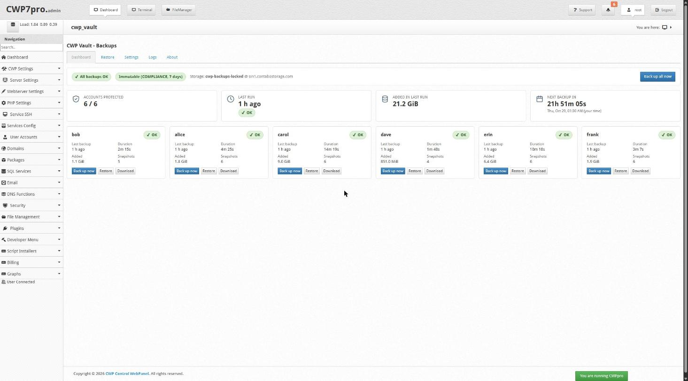
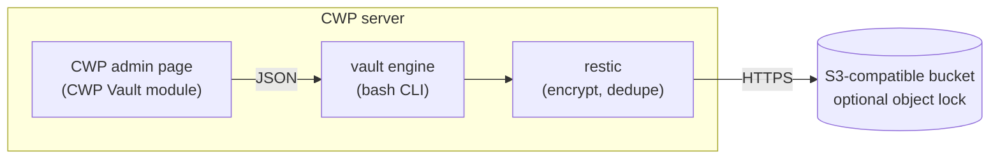
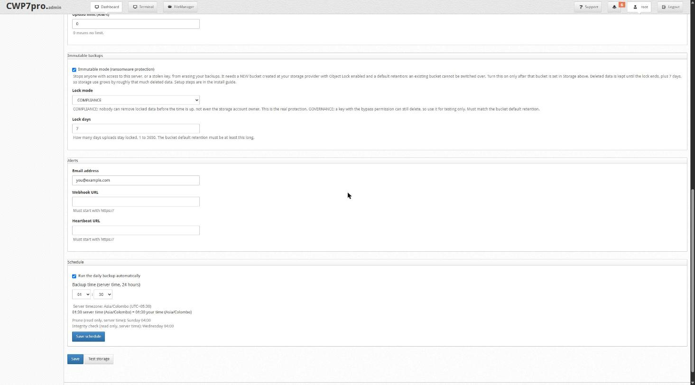

# CWP Vault

**Free, open-source (MIT) backups for CWP servers: encrypted, incremental, to any S3-compatible storage, with a native admin page and an optional ransomware-proof mode.**

[](https://github.com/riyajkm/cwp-vault/actions/workflows/ci.yml)
[](https://github.com/riyajkm/cwp-vault/releases)
[](LICENSE)
[](https://github.com/riyajkm/cwp-vault/stargazers)



> **Status: v0.5.0, early release.** Backup and restore are verified on a production CWP server
> (AlmaLinux 8, Contabo Object Storage). Test a restore on your own server before relying on it.

## Why

CWP's built-in "NEW Backup (beta)" is the only S3 option inside CWP, and its users report problems on the
[official forum](http://forum.centos-webpanel.com/backup/). CWP Vault is built around those pain points:

- **S3 settings that stay saved, and a restore that lists what is in the bucket.** Reported failures with the beta: credentials not saved, restore not listing S3 backups.
- **No temp copies filling the root disk.** Databases are streamed straight into the backup (`mysqldump --single-transaction`), with no staging files.
- **Retention that is built in.** Default 7 daily / 4 weekly / 3 monthly, pruned automatically, plus weekly integrity checks.

## Features

**Backups**
- One encrypted, incremental restic repository per account, plus one for server config (DNS, SSL, CWP config).
- Home files, mail and databases streamed into the backup, plus the account record.
- Retention with `restic forget --prune`; weekly integrity checks.
- Schedule editor (server time and your local time side by side) and a live countdown to the next backup.

**Safety and ransomware**
- **Immutable mode** with S3 object lock, and `vault recover` to undo an attacker's deletions. Tested end to end on Contabo.
- **Monthly automatic restore test**: imports every database into a throwaway copy and alerts on failure.
- Restic download verified by pinned SHA-256 and GPG signature.

**Restore and downloads**
- Safe restores: never into live data by default, symlink-proof targets, setuid stripped, every restore audit-logged.
- **Restore into the live account** (type the account name to confirm; a safety backup is taken first), single-database restore, single-mailbox restore, background restores with progress.
- **Download backups** as plain `.tar.gz` / `.sql.gz` or password-encrypted (GPG) files: admin-only signed links, auto-deleted after 24 h, audit-logged.

**Admin page (inside CWP)**
- First-run wizard, per-account status, back up now, file browser restore, settings with write-only keys, live log.

**Ops**
- Failure alerts by email or webhook, plus a heartbeat URL (healthchecks.io style).
- `vault` CLI for everything, with JSON output.
- `install.sh --upgrade` and `--check`.
- 250+ automated tests.

Planned: customer self-service restore, more notifiers, a CWP-update compatibility test. See the [roadmap](docs/ROADMAP.md).

## How it works



The admin page is a thin front end: it calls the `vault` engine and reads its JSON. The engine drives restic,
which encrypts on the server before anything is uploaded. With immutable mode on, the bucket's object lock keeps
deleted data recoverable even if the server is compromised. Details: [docs/ENGINE.md](docs/ENGINE.md).

## Install in 30 seconds

```bash
git clone https://github.com/riyajkm/cwp-vault.git && cd cwp-vault
sudo ./install.sh --dry-run   # see what it will do
sudo ./install.sh
```

Then open **CWP -> CWP Vault** and follow the setup wizard. Full guide: [docs/INSTALL.md](docs/INSTALL.md).

> Store the backup password the wizard shows you **offline**. Without it, nobody can read your backups.

## Screenshots




Screenshots use demo account names.

## How it compares

Checked 28 Oct 2026. Statements about CWP NEW Backup are user reports from the CWP forum, not CWP's own statements.
"Not verified" means we did not confirm it; it is not a claim either way.

| | CWP Vault | CWP NEW Backup (beta) |
|---|---|---|
| Price | Free, MIT | Free (bundled with CWP) |
| S3 storage | Yes (tested on Contabo) | Yes, with reported problems: [credentials not saved](http://forum.centos-webpanel.com/backup/backup-manager-beta-is-not-remembering-password-in-destination/), [restore not listing S3 backups](http://forum.centos-webpanel.com/backup/new-backup-beta-restore-account-gt-does-not-list-accounts-to-restore/) |
| Temp copies on server disk | No for databases (streamed) | Reported: [copies kept in tmp_back until all accounts finish](http://forum.centos-webpanel.com/backup/new-backup-beta-problems-still-not-fixed/) |
| Encryption | restic, client-side | Not verified |
| Incremental / dedup | Yes | Not verified |
| Immutable / object lock | Optional | Not documented |
| Maturity | Early; one production server tested | Described by users as [a long-running beta](http://forum.centos-webpanel.com/backup/new-backup-still-in-perpetual-beta-critical-issues-unresolved-for-months-cwp7/) |

## FAQ

**Is it secure?**
Backups are encrypted client-side by restic with a password only you hold. Lose it and nobody, including the author, can read them.
Storage keys are write-only in the admin page and stored in root-only files. Restores never write into live data by default,
setuid/setgid are stripped, and restores are audit-logged. Report vulnerabilities per [SECURITY.md](SECURITY.md).

**What does it cost?**
Your S3 storage bill. Restic deduplicates and compresses (in our first test a 0.9 GB account was stored as 313 MB).
In immutable mode, deleted data is held for `LOCK_DAYS` + 7 days, so budget extra.
<!-- TODO(owner): add a worked Contabo example (per-100-GB price) only after checking Contabo's current Object Storage price page, with a date and link. -->

**How long does a restore take?**
Measured on the reference server ([docs/research/stage0.md](docs/research/stage0.md)): a full restore of a 0.9 GB account to a temp folder took 45 s with 0 differences.
A single-database restore is import-bound: a 75-table, 18.7 MB database took 144 s. First backups are limited by your upload speed.

**Does it work with providers other than Contabo?**
It should, through restic's S3 backend (Wasabi, Backblaze B2, Cloudflare R2, MinIO, AWS S3), but only Contabo is tested. Reports welcome.

**What if an attacker gets root?**
In normal mode they can delete your backups with the key on the server. In immutable mode, object lock holds the deletes and `vault recover` restores them. Immutable mode needs a bucket created with object lock and the `aws` CLI v2; use COMPLIANCE mode for real protection, because GOVERNANCE can be bypassed by full-access keys. See [docs/research/immutable.md](docs/research/immutable.md) for what it does not cover.

**Can I uninstall it?**
Yes: `sudo ./uninstall.sh`. It keeps your config, secrets, logs, the restic binary and all remote backups unless you pass `--purge-local`, and it never touches remote storage.

## Built with cwp-forge

The admin module was built with [cwp-forge](https://github.com/riyajkm/cwp-forge), an agent skill pack that teaches AI coding agents how CWP modules really work.
Building your own CWP module? Start there.

## Contributing

Bug reports, restore reports and fixes are welcome. Help wanted: testers on AlmaLinux/Rocky 9, CentOS 7 and other S3 providers.
See [CONTRIBUTING.md](CONTRIBUTING.md), [docs/WORKFLOW.md](docs/WORKFLOW.md), the [security policy](SECURITY.md) and the [code of conduct](CODE_OF_CONDUCT.md).

## License

[MIT](LICENSE)
